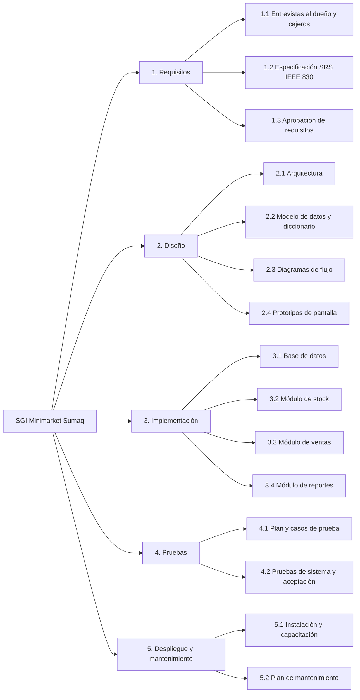
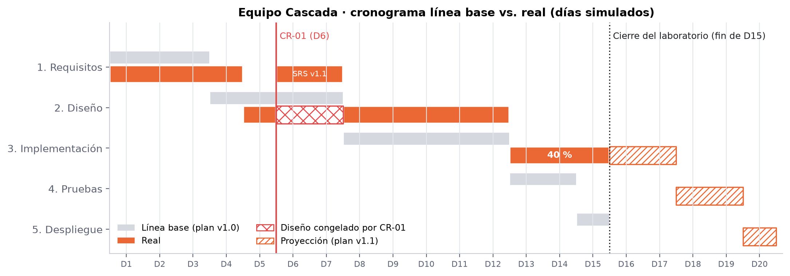

# Plan del proyecto (modelo en cascada)

**Proyecto:** Sistema de Gestión de Inventarios para Minimarket Sumaq · **Versión del plan:** 1.0 (línea base) / 1.1 (tras CR-01)

| Integrante | Rol |
|---|---|
| Mauricio Elías Congona Manrique | Jefe de proyecto y analista de requisitos |
| Javier Coronado Peña | Arquitecto y diseñador (modelo de datos, flujos, interfaz) |
| Anthony Leonel Chaisa Fernández | Analista programador y responsable de calidad (QA) |

## 1. Alcance
Sistema web para **control de stock**, **registro de ventas** y **generación de reportes** de una tienda minorista. Fuera de alcance: facturación electrónica SUNAT, multi-tienda, contabilidad.

## 2. Estructura de desglose del trabajo (EDT)

## 3. Cronograma línea base (15 días simulados = 3 semanas)

| Fase | Inicio | Fin | Duración | Hito / entregable de salida |
|---|---|---|---|---|
| 1. Requisitos | D1 | D3 | 3 d | SRS v1.0 aprobada por el cliente |
| 2. Diseño | D4 | D7 | 4 d | Documento de diseño aprobado |
| 3. Implementación | D8 | D12 | 5 d | Código fuente y base de datos |
| 4. Pruebas | D13 | D14 | 2 d | Informe de pruebas y acta de aceptación |
| 5. Despliegue y mantenimiento | D15 | — | 1 d + continuo | Sistema instalado, manual y plan de mantenimiento |

**Regla de transición entre fases:** una fase solo inicia cuando el entregable de la anterior está aprobado (revisión formal con el cliente y firma del jefe de proyecto).

## 4. Matriz RACI

| Entregable | Congona | Coronado | Chaisa | Cliente |
|---|---|---|---|---|
| SRS | R/A | C | C | A (aprueba) |
| Arquitectura y modelo de datos | C | R | C | I |
| Diagramas de flujo y prototipos | C | R | C | C |
| Script de base de datos | I | C | R | — |
| Plan de pruebas | A | C | R | I |
| Control de cambios | R/A | C | C | A |

## 5. Riesgos

| Riesgo | Prob. | Impacto | Respuesta |
|---|---|---|---|
| Cambios de requisitos después de aprobar la SRS | Media | Alto | Procedimiento formal de control de cambios (CR) |
| Retraso de una fase bloquea todas las siguientes | Alta | Alto | Holgura en pruebas; seguimiento diario de avance |
| El cliente no ve software hasta el final | Alta | Medio | Prototipos de pantalla en la fase de diseño |
| Subestimación de la implementación | Media | Alto | Priorizar módulos de stock y ventas |
