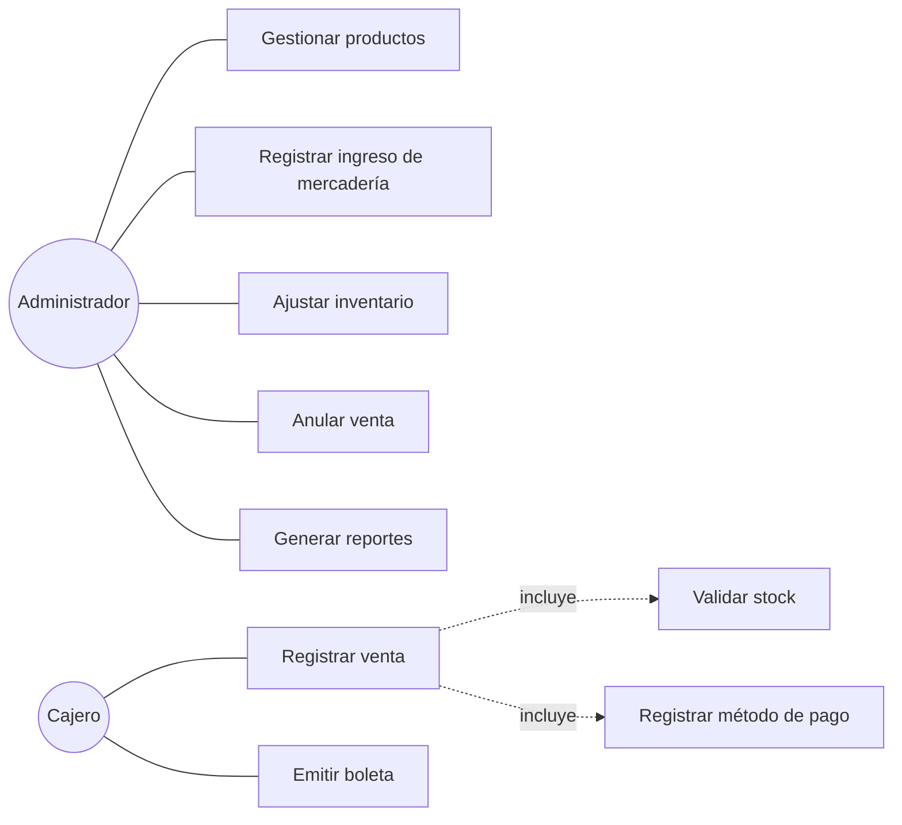

# Especificación de Requisitos de Software (SRS) — IEEE 830

**Versión:** 1.1 (incluye CR-01) · **Elaborado por:** M. Congona (analista) · **Revisado por:** J. Coronado, A. Chaisa · **Aprobado por:** dueño de Minimarket Sumaq

| Versión | Cambio |
|---|---|
| 1.0 | Línea base aprobada al cierre de la fase de requisitos (D4) |
| 1.1 | CR-01: método de pago en ventas y reporte de cierre de caja (RF-09, RF-15, RN-06) |

## 1. Introducción
**1.1 Propósito.** Definir los requisitos del sistema de gestión de inventarios de Minimarket Sumaq.
**1.2 Alcance.** El sistema controla el stock, registra ventas y emite reportes para el dueño. No incluye facturación electrónica ni contabilidad.
**1.3 Definiciones.** *SKU*: código interno del producto. *Kardex*: registro cronológico de entradas y salidas. *Stock mínimo*: nivel bajo el cual se debe reponer. *IGV*: impuesto general a las ventas (18 %).

## 2. Descripción general
- **Usuarios:** administrador (dueño), cajero.
- **Entorno:** navegador web en una PC de caja; conexión a internet no garantizada.
- **Restricciones:** software libre o gratuito, sin costo de licencias; precios con IGV incluido.

## 3. Requisitos funcionales

| ID | Requisito | Prioridad |
|---|---|---|
| RF-01 | Registrar productos con SKU único, nombre, categoría, unidad, costo, precio y stock mínimo | Alta |
| RF-02 | Modificar y desactivar productos sin borrar su historial | Alta |
| RF-03 | Buscar productos por nombre, SKU o categoría | Media |
| RF-04 | Registrar ingresos de mercadería (cantidad, costo unitario, proveedor) y recalcular el costo promedio | Alta |
| RF-05 | Registrar ajustes por inventario físico con motivo | Media |
| RF-06 | Emitir alertas de productos con stock ≤ stock mínimo | Alta |
| RF-07 | Mostrar el kardex de cada producto con saldo | Media |
| RF-08 | Registrar ventas con uno o más productos, descontando el stock | Alta |
| RF-09 | Registrar el método de pago de cada venta: efectivo, tarjeta, Yape o Plin *(CR-01)* | Alta |
| RF-10 | Impedir ventas con cantidad mayor al stock disponible | Alta |
| RF-11 | Anular ventas con motivo y devolver el stock | Media |
| RF-12 | Emitir comprobante (boleta) imprimible | Media |
| RF-13 | Reporte de ventas por período | Alta |
| RF-14 | Reporte de productos más vendidos | Alta |
| RF-15 | Reporte de ventas por método de pago (cierre de caja) *(CR-01)* | Alta |
| RF-16 | Reporte de inventario valorizado y lista de reposición | Media |
| RF-17 | Exportar reportes a CSV | Baja |

## 4. Requisitos no funcionales

| ID | Tipo | Requisito |
|---|---|---|
| RNF-01 | Rendimiento | Registrar una venta en menos de 2 s con un catálogo de hasta 5 000 productos |
| RNF-02 | Usabilidad | Un cajero nuevo registra una venta tras 15 min de capacitación; interfaz en español |
| RNF-03 | Seguridad | Solo el administrador anula ventas y ajusta stock; registro del usuario en cada movimiento |
| RNF-04 | Disponibilidad | Funciona sin conexión a internet durante la jornada; respaldo diario |
| RNF-05 | Integridad | El stock nunca es negativo; ventas atómicas (todo o nada) |
| RNF-06 | Portabilidad | Funciona en Chrome, Edge y Firefox actuales, en PC y tablet |
| RNF-07 | Mantenibilidad | Código versionado en Git y documentado |
| RNF-08 | Costo | Herramientas y despliegue gratuitos |

## 5. Reglas de negocio

| ID | Regla |
|---|---|
| RN-01 | El precio de venta no puede ser menor que el costo |
| RN-02 | El costo del producto es el promedio ponderado de sus ingresos |
| RN-03 | Los precios incluyen IGV; operación gravada = total / 1,18 |
| RN-04 | Los comprobantes siguen la serie B001 con correlativo de 6 dígitos |
| RN-05 | Una venta anulada no se elimina; cambia a estado ANULADA |
| RN-06 | En pagos en efectivo se registra el monto recibido y el vuelto *(CR-01)* |

## 6. Casos de uso principales

