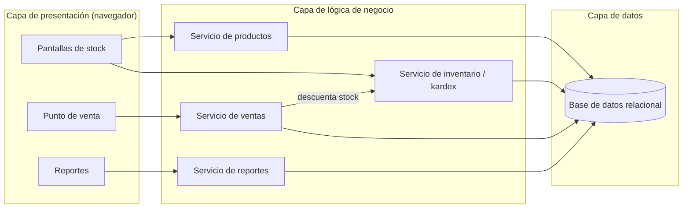
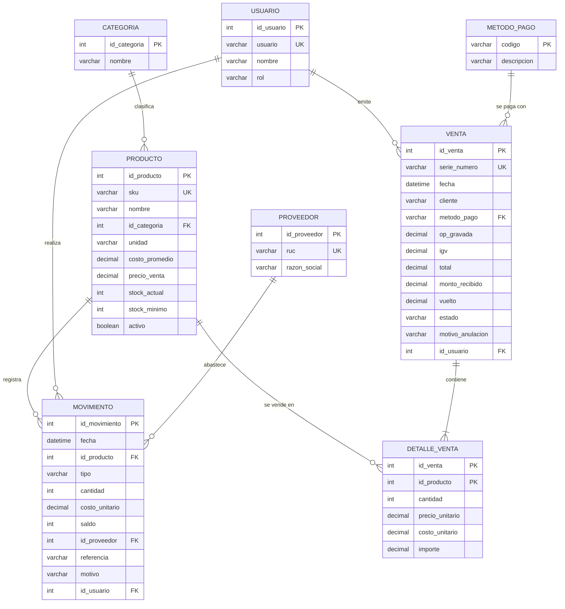
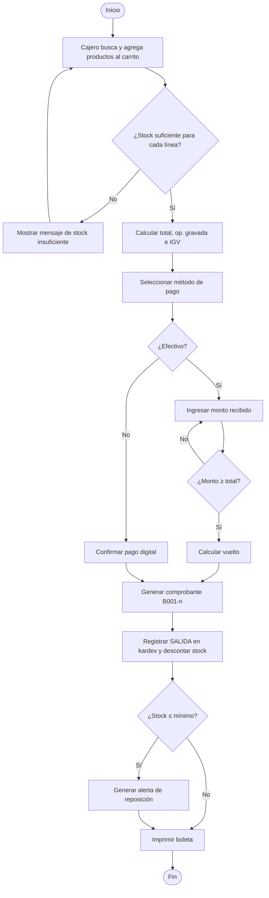
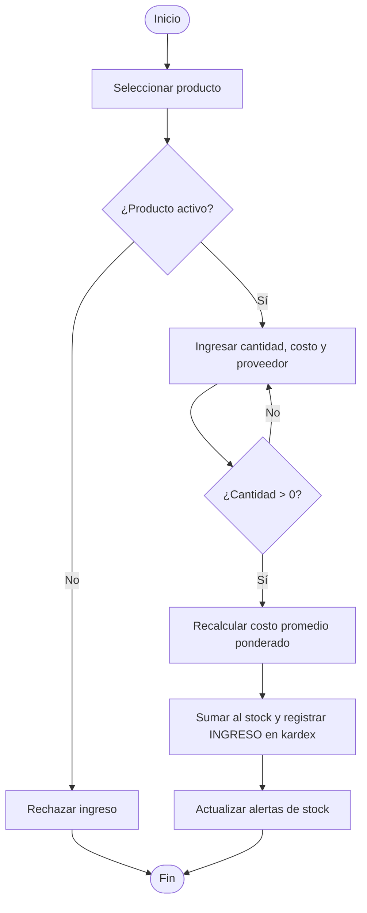
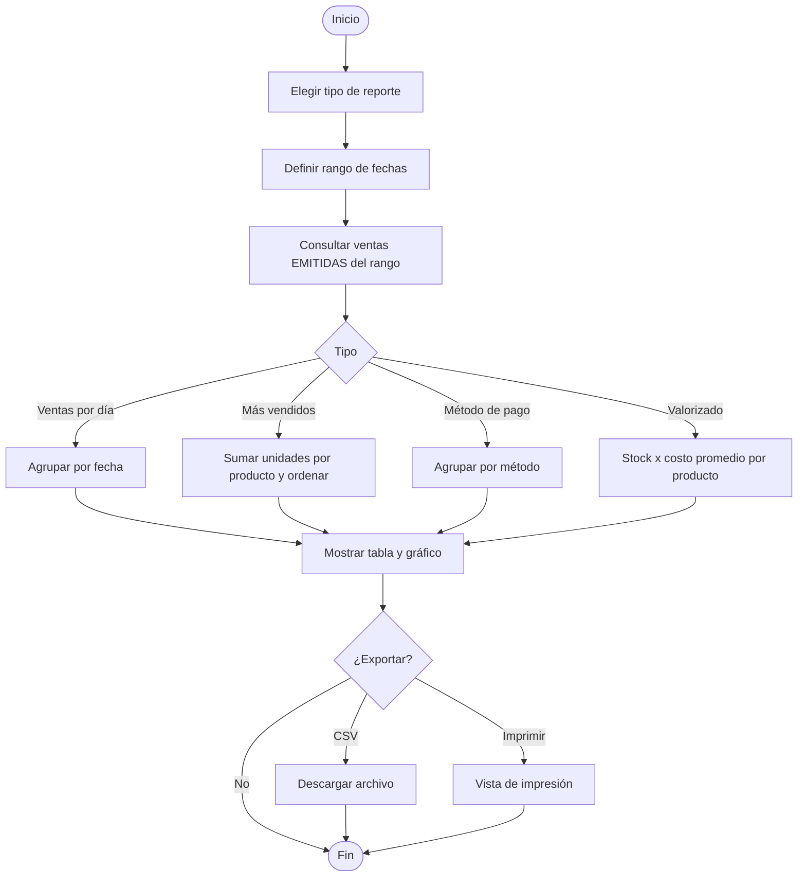

# Documento de diseño del sistema

**Versión:** 1.1 · **Responsable:** Javier Coronado Peña · **Revisión:** Mauricio Congona, Anthony Chaisa

## 1. Arquitectura

Arquitectura en tres capas. La capa de datos es una base relacional (SQLite en la tienda; migrable a PostgreSQL).

## 2. Modelo de datos (entidad–relación)

> Las entidades `METODO_PAGO` y los campos `metodo_pago`, `monto_recibido` y `vuelto` se agregaron en la versión 1.1 por la solicitud de cambio CR-01.

## 3. Diccionario de datos (extracto)

| Tabla | Campo | Tipo | Restricción | Descripción |
|---|---|---|---|---|
| producto | sku | VARCHAR(20) | UNIQUE, NOT NULL | Código interno |
| producto | precio_venta | DECIMAL(10,2) | CHECK ≥ costo_promedio | Precio con IGV |
| producto | stock_actual | INTEGER | CHECK ≥ 0 | Saldo vigente |
| movimiento | tipo | VARCHAR(10) | IN (INGRESO, SALIDA, AJUSTE, DEVOLUCION) | Naturaleza del movimiento |
| movimiento | saldo | INTEGER | CHECK ≥ 0 | Stock después del movimiento |
| venta | serie_numero | VARCHAR(12) | UNIQUE | B001-000001 |
| venta | estado | VARCHAR(8) | IN (EMITIDA, ANULADA) | Estado del comprobante |
| venta | metodo_pago | VARCHAR(10) | FK método_pago | Efectivo, tarjeta, Yape, Plin |

## 4. Diagramas de flujo

### 4.1 Registrar venta

### 4.2 Ingreso de mercadería (control de stock)

### 4.3 Generación de reportes

## 5. Prototipos de pantalla
Ver imágenes `docs/diagramas/wireframe-*.png` (punto de venta y lista de productos), elaboradas en la fase de diseño y validadas con el dueño.
