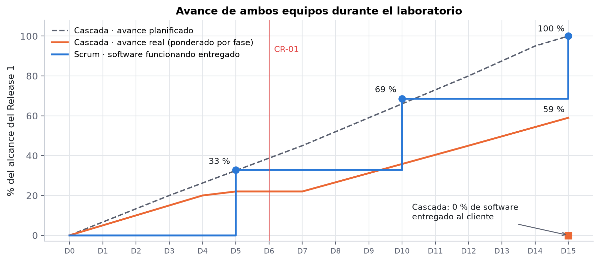

# Comparación Scrum vs. Cascada en este proyecto

| Aspecto | Equipo Scrum | Equipo Cascada |
|---|---|---|
| Planificación inicial | Product Backlog de 67 SP y release de 3 sprints | Plan completo: EDT, cronograma de 15 días, RACI y riesgos |
| Primer resultado visible para el cliente | Día 5: software funcionando (catálogo, ingresos, alertas, kardex) | Día 4: SRS v1.0 (documento) |
| Cambio CR-01 / HU-11 (métodos de pago) | Nueva historia de 3 SP en el Sprint 2; sin retraso del release | Reapertura de la SRS, diseño congelado 2 días, +4 días al cronograma |
| Avance al cierre (día 15) | 70/70 SP, Release 1 publicado | 59 % ponderado; implementación al 40 % |
| Software entregado | Sí: https://owerlopez.github.io/gsti-lab03-sigi-inventarios/ | No (la entrega se proyecta al día 20) |
| Documentación | Backlog, criterios de aceptación, dailies, reviews y retrospectivas | SRS IEEE 830, diseño, ER, diccionario de datos, flujos, plan de pruebas |
| Fortaleza observada | Adaptabilidad y retroalimentación temprana | Trazabilidad y control formal de cambios |
| Debilidad observada | Sobreestimación en el Sprint 1 (26 vs. 23 SP) | Rigidez: un cambio tardío afecta a todas las fases siguientes |

**Conclusión del grupo:** para una tienda minorista cuyo dueño cambia de idea al ver el producto, Scrum fue más eficiente. La cascada aportó artefactos valiosos (modelo de datos, reglas de negocio, plan de pruebas) que convendría conservar en un enfoque híbrido.
